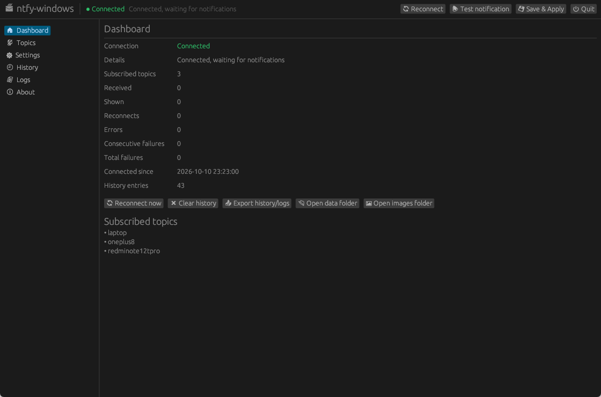

# ntfy-windows

**English** | [简体中文](README.md)

A Windows notification daemon written in **Rust**: it subscribes to [ntfy.sh](https://ntfy.sh)
(or a self-hosted ntfy server) and forwards incoming messages to **native Windows toast
notifications**. It ships with a lightweight GUI (egui) for configuration, history and logs,
plus a headless tray mode.

## Screenshot



---

## Contents

- [Screenshot](#screenshot)
- [Features](#features)
- [Project layout](#project-layout)
- [Build](#build)
- [Run](#run)
- [Configuration](#configuration)
- [UI language (i18n)](#ui-language-i18n)
- [Reconnect & single instance](#reconnect--single-instance)
- [Authentication](#authentication)
- [Auto-start](#auto-start)
- [Packaging](#packaging)
- [Priority mapping](#priority-mapping)
- [Troubleshooting](#troubleshooting)

---

## Features

- **Long-running background service**: a tokio async daemon with automatic reconnect
  (exponential backoff, up to 120 s), graceful shutdown and resource cleanup.
- **Full ntfy protocol** (official path-based API):
  - JSON stream `/{topic}/json`, SSE `/{topic}/sse`, WebSocket `/{topic}/ws`,
    polling `/{topic}/json?poll=1`. The default `auto` falls back JSON → SSE → WS → poll.
  - Multiple topics: `/{topic1,topic2}/json`.
  - Text, title, priority (1–5), tags / emojis, attachments, click URL, action buttons, icon.
- **Native Windows notifications** via WinRT `ToastNotificationManager` with a registered
  `AppUserModelID`, so toasts persist in the Action Center.
- **Priority mapping**: different ntfy priorities map to sound / duration / silent behaviour.
- **Authentication**: Basic Auth and Bearer token for private topics.
- **GUI (egui / eframe)**: server / auth / topics / notification options / log level,
  connection status and stats, filterable history, live logs, manual reconnect, history
  clearing, export, test notification, auto-start toggle.
- **System tray**: GUI mode hides to tray on close; `--no-gui` is a **tray-only background**
  mode with no GUI window (near-zero CPU). Right-click for show / reconnect / test /
  open config / quit.
- **Low CPU**: the GUI repaints on demand (near 0 FPS when idle); use `--no-gui` to avoid
  GUI rendering entirely. `--cpu-debug` prints CPU / repaint diagnostics.
- **Portable configuration**: `config.json` next to the executable (falls back to
  `%APPDATA%\ntfy-windows\config.json`); legacy `config.toml` is migrated automatically.
- **CJK fonts**: system CJK fonts (Microsoft YaHei / SimHei, …) are loaded automatically.
- **Logging**: `tracing` + `tracing-subscriber`, daily rolling files mirrored into the GUI.
- **Attachment images**: previewed in the toast and archived to a persistent folder
  (default `%LOCALAPPDATA%\ntfy-windows\images`, named like `20261009-215349_laptop_photo.jpg`),
  openable from the history.
- **i18n**: independent language files, Chinese and English built in.

> ntfy **attachments require `attachment-cache-dir` on the server** (enabled on ntfy.sh).

---

## Project layout

```
src/
├── main.rs               # entry point: CLI, runtime, GUI / headless dispatch
├── config.rs             # config model, JSON read/write, paths
├── models.rs             # ntfy JSON models (NtfyMessage / Action / Attachment)
├── ntfy_client.rs        # async subscription client (/json, /sse, /ws, poll)
├── daemon.rs             # daemon: reconnect, filter, forward, image archiving
├── windows_notifier.rs   # Windows toast backend (WinRT) and XML generation
├── state.rs              # shared state, commands, history, log buffer
├── logging.rs            # tracing setup (file + GUI)
├── autostart.rs          # HKCU Run auto-start
├── emoji.rs              # ntfy tags -> unicode emoji
├── gui.rs                # egui control panel (GUI mode)
├── tray.rs               # tray icon + headless (--no-gui) message loop
├── cpu_debug.rs          # --cpu-debug CPU / repaint diagnostics
├── i18n.rs               # translation lookup
lang/
├── en-US.toml            # English translation
└── zh-CN.toml            # Chinese (source language)
packaging/
├── ntfy-windows.iss      # Inno Setup script
└── register-task.ps1     # optional Task Scheduler registration
config.example.json       # example configuration
```

---

## Build

Prerequisites:

- [Rust stable](https://rustup.rs/) (MSVC target, e.g. `x86_64-pc-windows-msvc`)
- Windows 10 1809+ / Windows 11
- **Visual Studio Build Tools** (C++ build tools + Windows SDK)

```powershell
cargo build            # debug (shows a console window)
cargo build --release  # release (no console, smaller binary)
```

The binary is at `target\release\ntfy-windows.exe`.

---

## Run

```powershell
# GUI (the daemon runs in the same process)
.\ntfy-windows.exe

# Tray-only background mode (no GUI window, near-zero CPU)
.\ntfy-windows.exe --no-gui

# Use a specific config file
.\ntfy-windows.exe --config D:\configs\ntfy.json

# Print CPU diagnostics every 10 s
.\ntfy-windows.exe --no-gui --cpu-debug

# Install / uninstall auto-start (HKCU Run, uses --no-gui)
.\ntfy-windows.exe --install-autostart
.\ntfy-windows.exe --uninstall-autostart

# Help
.\ntfy-windows.exe --help
```

On first launch a `config.json` is created next to the executable (or under
`%APPDATA%\ntfy-windows\` if that folder is not writable). Add topics in the GUI
"Topics" tab, or edit the file and restart.

> **Two background modes**
> - `--no-gui`: **no GUI window**, only a tray icon (recommended, near-zero CPU).
>   Right-click: reconnect / test / open config / open data folder / quit.
> - GUI mode: closing the window hides it to the tray; left-click shows it again.
>
> Use `--no-gui` to avoid eframe/egui rendering entirely.

---

## Configuration

Default path: `<program dir>\config.json` (or `--config`; legacy `.toml` files are still read).

```json
{
  "topics": ["mytopic", "alerts"],
  "autostart": false,
  "server": {
    "base_url": "https://ntfy.sh",
    "insecure_tls": false
  },
  "auth": {
    "method": "none",
    "username": "",
    "password": "",
    "token": ""
  },
  "connection": {
    "transport": "auto",
    "retry_initial_secs": 2,
    "retry_max_secs": 120,
    "retry_max_attempts": 0,
    "poll_interval_secs": 15
  },
  "notification": {
    "enabled": true,
    "min_priority": 1,
    "sound": true,
    "show_attachments": true,
    "download_images": true,
    "max_image_mb": 10,
    "app_name": "ntfy-windows",
    "app_id": "com.ntfy.windows",
    "app_icon": "",
    "ignore_topics": "",
    "save_images": true,
    "image_dir": ""
  },
  "ui": {
    "theme": "dark",
    "history_limit": 500,
    "font_path": "",
    "close_to_tray": true,
    "language": "system"
  },
  "logging": {
    "level": "info"
  }
}
```

Data locations:

| File | Path |
| --- | --- |
| Config | `<program dir>\config.json` (fallback: `%APPDATA%\ntfy-windows\config.json`) |
| History | `%APPDATA%\ntfy-windows\history.json` |
| Logs | `%LOCALAPPDATA%\ntfy-windows\logs\ntfy-windows.log.YYYY-MM-DD` |
| Image cache | `%LOCALAPPDATA%\ntfy-windows\cache\` |
| Image archive | `<image_dir>` (default `%LOCALAPPDATA%\ntfy-windows\images\`) |
| Exports | `%LOCALAPPDATA%\ntfy-windows\exports\` |

---

## UI language (i18n)

- Switch language in "Settings → UI & Logs → Language", stored as `ui.language`:
  `system` / `zh-CN` / `en-US`.
- UI text, the tray menu, and **runtime logs** all follow the selected language.
- Chinese and English are built in. **Adding or overriding a language needs no recompile**:
  drop a `lang/<code>.toml` next to the executable (e.g. `lang/ja-JP.toml`). The keys are the
  Chinese source strings, the values are the translation:
  ```toml
  "设置" = "設定"
  "已导出到 {path}" = "{path} にエクスポートしました"
  ```
  See [`lang/en-US.toml`](lang/en-US.toml) for the full key set.

---

## Reconnect & single instance

- **Failure counting / backoff**: the backoff only resets once a connection actually
  delivers data (a message or a keepalive). A connection that is accepted and immediately
  closed (proxy/server issue) increases the failure counter with exponential backoff; the
  dashboard shows consecutive/total failures.
- **Configurable retries** (`connection`):
  - `transport`: `auto` (JSON → SSE → WS → poll) / `json` / `sse` / `ws` / `poll`
  - `retry_initial_secs`, `retry_max_secs`, `retry_max_attempts` (`0` = unlimited)
  - `poll_interval_secs`: polling interval
- **Single instance**: a loopback port (`127.0.0.1:49723`) guarantees only one instance
  runs; a second launch exits with a log message.
- **Tray quit**: the tray menu and the window "Quit" button really terminate the process.

> Subscribe URLs follow the official API: the topic is in the **path**, e.g.
> `https://host/{topic}/json`, `/{topic}/sse`, `/{topic}/ws`; multiple topics:
> `/{topic1,topic2}/json`.

---

## Authentication

- **Basic Auth**: `"method": "basic"`, set `username` / `password`.
- **Bearer Token**: `"method": "token"`, set `token` (e.g. `tk_xxxxxxxx`).

These become `Authorization: Basic …` / `Authorization: Bearer tk_…`.

---

## Auto-start

### Option 1: registry (default, no admin)

```powershell
.\ntfy-windows.exe --install-autostart     # writes HKCU\...\Run with --no-gui
.\ntfy-windows.exe --uninstall-autostart
```

Or tick "Auto-start" in the GUI and click "Save & Apply".

```
HKEY_CURRENT_USER\Software\Microsoft\Windows\CurrentVersion\Run
    ntfy-windows = "C:\path\to\ntfy-windows.exe" --no-gui
```

> `--no-gui` (headless tray, near-zero CPU) is the default. Use `--minimized` instead if
> you want the GUI to start hidden in the tray.

### Option 2: Task Scheduler (optional, more robust)

```powershell
powershell -ExecutionPolicy Bypass -File packaging\register-task.ps1 -ExePath "C:\path\to\ntfy-windows.exe"
```

### Option 3: Windows service

Wrap it with [NSSM](https://nssm.cc/) or [WinSW](https://github.com/winsw/winsw):

```powershell
nssm install ntfy-windows "C:\path\to\ntfy-windows.exe" --no-gui
nssm start ntfy-windows
```

---

## Packaging

```powershell
cargo build --release
iscc packaging\ntfy-windows.iss            # -> dist\ntfy-windows-setup-x.y.z.exe

# Optional MSI
cargo install cargo-wix
cargo wix init
cargo wix
```

---

## Priority mapping

| ntfy priority | Meaning | Windows toast |
| --- | --- | --- |
| 1 (min) | lowest | silent (`<audio silent="true"/>`) |
| 2 (low) | low | default sound |
| 3 (default) | default | default sound |
| 4 (high) | high | `Notification.IM` + `duration="long"` |
| 5 (max) | urgent | `Notification.Looping.Alarm` + `duration="long"` |

- `notification.sound = false` mutes everything.
- `notification.min_priority` filters out lower priorities.
- Known emoji tags are added to the title; unknown tags are appended as `#tag`.
- `click` becomes the toast body click action; `view` actions become toast buttons.
  `broadcast` (Android) and `http` actions are ignored on Windows.

---

## Troubleshooting

| Symptom | What to check |
| --- | --- |
| No notifications | Check the dashboard status and logs; verify the topic and auth; use "Test notification". |
| Repeated "connection closed immediately" | Usually a reverse proxy / Cloudflare buffering the NDJSON stream. Set `transport` to `sse` / `ws` (or keep `auto`). |
| Logs show an HTML page | The request hit the ntfy web UI, not the API. Check `base_url` (self-hosted subpaths) — the URL must look like `/{topic}/json`. |
| Tray left-click does nothing | Left-click shows the window, right-click opens the menu. Enable `debug` logs to see tray events. |
| Attachment image not shown | The server must enable attachments; images are downloaded and re-encoded. Check "已缓存通知图片" / failure logs. |
| GUI high CPU in background | Use `--cpu-debug` to see CPU / repaint rate, or use `--no-gui` for long-running background use. |
| TLS errors | For self-signed certs you may temporarily set `insecure_tls` (not recommended). |
| Auto-start not working | Run `--install-autostart`; check `HKCU\...\Run`; use an absolute path. |

Enable verbose logging:

```powershell
$env:RUST_LOG = "ntfy_windows=debug"
.\ntfy-windows.exe --no-gui
```

---

## License

MIT — see [LICENSE](LICENSE).
